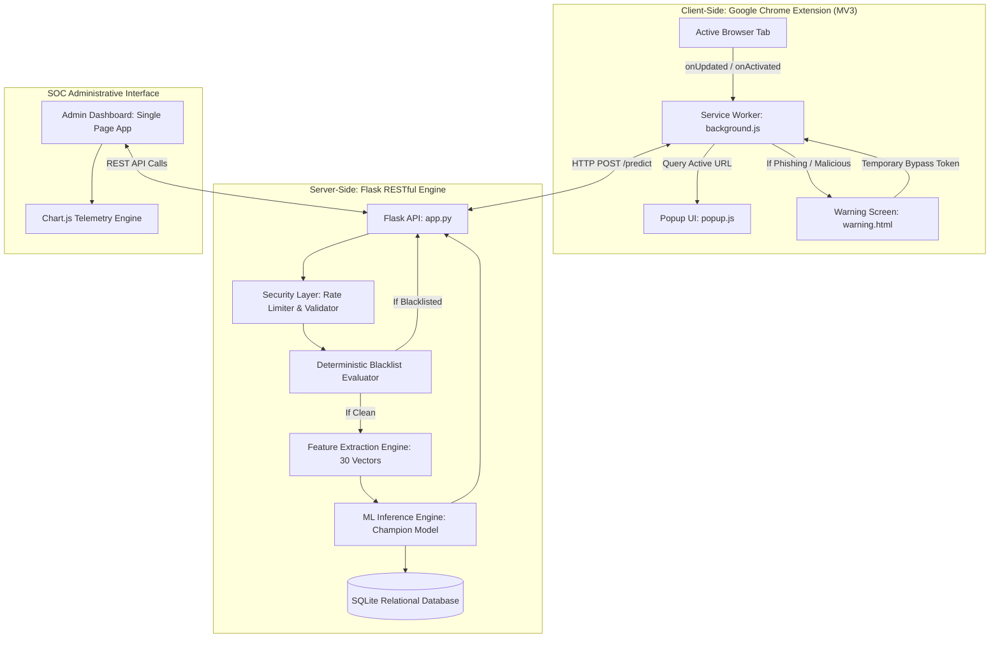

# PHISH GUARD - System Architecture & Engineering Specifications

This document outlines the high-level architecture, data flow, component interactions, security controls, and machine learning pipeline of **PHISH GUARD**.

---

## 1. High-Level Architecture Overview

PHISH GUARD is architected following the **Defense-in-Depth** cybersecurity principle, combining deterministic security layers (deterministic blacklists, URI validation, regex rules) with probabilistic Machine Learning classification (trained estimators and statistical feature engineering).

---

## 2. Component Breakdown

### 2.1 Browser Extension (Manifest V3)
* **`manifest.json`**: Chrome MV3 compliant manifest utilizing minimal necessary permissions (`tabs`, `activeTab`, `storage`).
* **`background.js`**: Persistent service worker listening to tab lifecycle events, managing in-memory and local storage caches, setting badge colors (`SAFE` in green, `WARN` in yellow, `DANG`/`CRIT` in red), and intercepting malicious navigation to reroute to `warning.html`.
* **`popup.html / css / js`**: Modern extension popup providing real-time verdict, confidence level, latency metrics, collapsible 30-feature vector viewer, and community feedback form.
* **`warning.html / css / js`**: Full-screen blocking interception screen preventing user interaction with malicious web resources, with temporary bypass capability and threat explanation.

### 2.2 Flask REST API Backend
* **`app.py`**: Central application gateway exposing endpoints for prediction, blacklist CRUD, telemetry statistics, model benchmarking, and feedback reports.
* **`security_utils.py`**: Defends backend endpoints via OWASP-recommended security headers (CSP, HSTS, X-Content-Type-Options), RFC-compliant URL sanitization, and sliding-window IP rate limiting.
* **`feature_extractor.py`**: High-performance feature extractor extracting 30 lexical, structural, statistical, and security signals from raw URLs in sub-2ms.
* **`model_service.py`**: Model lifecycle manager performing inference, probability calibration, risk level categorization, and fail-safe heuristic fallback.
* **`database_manager.py`**: Parameterized SQLite ORM wrapper ensuring SQL-injection immunity.

### 2.3 Machine Learning Pipeline
* **`generate_dataset.py`**: Synthesizes thousands of diverse legitimate, brand-spoofed, IP-based, and obfuscated URLs.
* **`data_preprocessing.py`**: Cleans data, eliminates duplicates, and constructs feature matrices.
* **`train_models.py`**: Multi-model benchmarking framework training 7 distinct algorithms:
  1. Gradient Boosting
  2. Random Forest
  3. Support Vector Machine (SVC)
  4. Logistic Regression
  5. K-Nearest Neighbors (KNN)
  6. Decision Tree
  7. Gaussian Naive Bayes

---

## 3. Data Flow Diagram

1. **URL Interception**: User attempts to navigate to a target website.
2. **Tab Event Trigger**: `chrome.tabs.onUpdated` captures the target URL and queries `background.js`.
3. **Cache Lookup**: `background.js` verifies if the URL has been scanned recently. If cached, badge is updated immediately.
4. **API Request**: If not cached, `background.js` sends `POST /predict` with `{ "url": "..." }` to the Flask backend.
5. **Rate Limiting & Sanitization**: Flask security middleware validates format and rate limit window.
6. **Blacklist Check**: URL is cross-referenced with SQLite `Blacklist`. If matched, classified as `Malicious` (Confidence: 99.9%) without running ML.
7. **Feature Extraction**: 30 lexical vectors are computed.
8. **Estimator Inference**: Scaled vectors are passed to the champion model (`model.pkl`), computing probability $P(\text{Phishing})$.
9. **Defense-in-Depth Calibration**: Probabilities are merged with heuristic rules (e.g. IP address or brand spoofing flags guarantee elevated status).
10. **Telemetry & Response**: Result is logged to SQLite `ScanHistory` and returned as JSON.
11. **Client Action**: If safe, green badge is shown; if suspicious, amber badge is shown; if phishing, user is redirected to `warning.html`.
